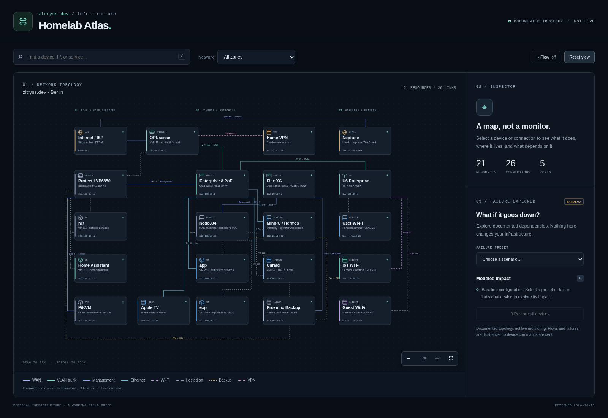
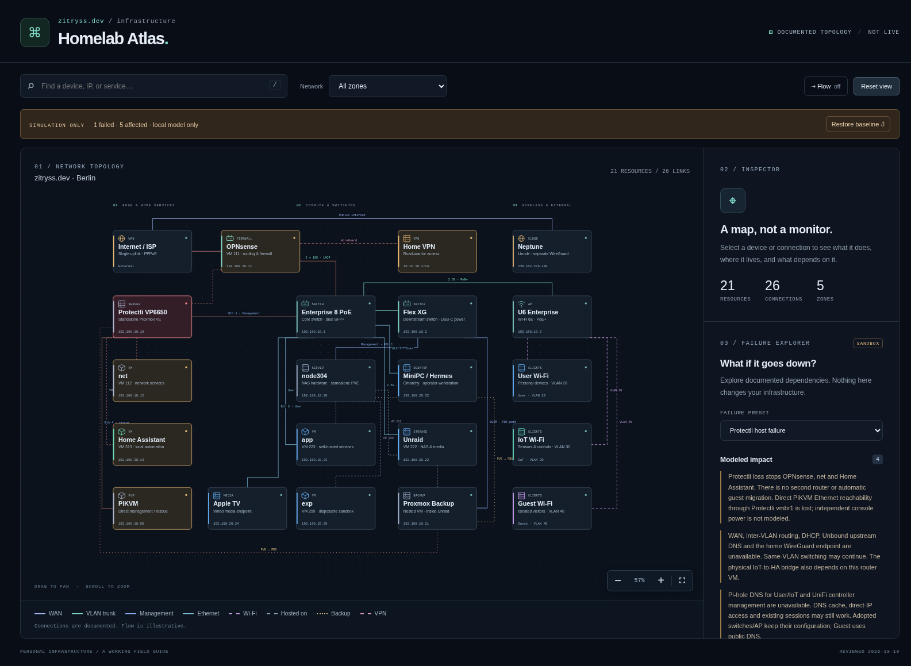

# Homelab Atlas

My homelab: how the network, servers, virtual machines and services fit together. An interactive map with simulated failures—not live monitoring.

[Terraform](https://github.com/zitryss/terraform) provisions the VMs; [Ansible](https://github.com/zitryss/ansible) configures the hosts.

Inspired by [Leox’s homelab map](https://github.com/Leox1024/homelab-docs). · [Run locally](docs/DEVELOPMENT.md)
